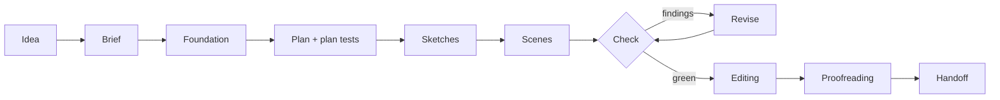

  

<h1 align="center">Sommer auf Gut Lindenhof</h1>

<strong>Karla Lind</strong> · A German romance novel in dime-novel format

<a href="docs/sommer-auf-gut-lindenhof.pdf">Read the PDF</a> · <a href="docs/sommer-auf-gut-lindenhof.epub">Download the EPUB</a>

A gardener, an overgrown rose garden and an heir from Hamburg who wants to sell. Written in a book factory: agents write, tests decide.

## Auf Deutsch

*Sommer auf Gut Lindenhof* ist ein Liebesroman im Heftformat, von einer Buchfabrik nach dem Vorbild der Agentic Software Factory durchproduziert: KI-Agenten planen, schreiben und überarbeiten, 497 deterministische Prüfungen mit fester ID entscheiden über jeden Schritt, und an festen Gates gibt ein Mensch frei. Von einer Idee in fünf Zeilen bis zu EPUB und PDF vergingen 54 Stunden, 515 Agentenläufe und 48 Millionen Token. Die Stilvorlage ist an Kennzahlen zweier frei lizenzierter Heftromane geeicht. Dieses Repo ist das Buch mit seiner vollständigen Spur: Plantests, Befunde, Freigaben und jeder Commit. Lesen als [PDF](docs/sommer-auf-gut-lindenhof.pdf) oder [EPUB](docs/sommer-auf-gut-lindenhof.epub).

## The book factory in four sentences

The book factory is to novels what the agentic software factory is to code. AI agents plan, write and revise. Hundreds of deterministic checks decide whether a chapter may move on, and a human approves at fixed gates. A five-line idea became an EPUB and a PDF in 54 hours, and this repository is the result, with its complete commit trail.

## The book

The novel is in German. Its blurb, translated:

> An overgrown rose garden. An heir who wants to sell. And only one summer until the harvest festival.
>
> When gardener Marie Albers takes on the job of saving the rose garden of Gut Lindenhof, she has no idea how much her client will get on her nerves. Jonas Behrendt, a civil engineer from Hamburg, wants to level the paths, keep to schedule and be rid of the estate as fast as he can. Marie wants only one thing: for Hedwig's last Lindenhof rose to bloom again.
>
> But summer in the country has plans of its own. Grete's cakes, Hannes' tractor, Lena's list of helpers and an evening at the estate lake bring Marie and Jonas closer than either would like. And Jonas discovers that this estate was once his home.
>
> Yet between them stands a decision Jonas has to make alone – and a secret that could break Marie's heart.
>
> A novel about roses, pruning and the courage to put down roots.

10 chapters, 27 scenes, about 23,700 words.

## The software factory, applied to books

The factory takes the way good software teams work and carries it over to storytelling, step by step:

| Software        | Book                                                     |
| --------------- | -------------------------------------------------------- |
| Specification   | Brief: audience, tone, the promise to the reader         |
| Architecture    | Foundation: premise, characters, places, plot threads    |
| Unit tests      | Plan tests per scene, written before the first sentence  |
| Linter          | Check rules with a stable ID, each with its own test     |
| Code review     | Chapter review, editing, simulated test readers          |
| CI gates        | Approvals at every station                               |
| Feature branch  | Factory strand, merged only when everything is green     |
| Release         | Handoff: EPUB, PDF, cover, store data                    |

The rule behind it: whatever can be counted is counted by a program, not a model. The model judges only where judgement is needed, and even then it must back every finding with a quote from the text.

## In numbers

| | |
| --- | --- |
| From idea to finished book | 54 hours |
| Pure compute time of the agents | 18.6 hours |
| Agent runs | 515 |
| Tokens | 48 million |
| Commits | about 640 at the merge |
| Plan tests | 492 |
| Revisions | 78, on 24 of 27 scenes, at most 5 per scene |
| Chapter reviews / re-checks / consistency runs | 70 / 50 / 14 |
| Read-aloud passes (sound only) | 10 |
| Simulated test readers / editing passes | 2 / 1 |
| Findings | 683, of which 127 fixed, most of the rest notes |

## Deterministic checks

497 rules, each with a stable ID and its own test. They run at every step, like a linter on every commit.

| Family | Rules | An example |
| --- | ---: | --- |
| AI tone and stock phrases | 248 | Formulas that give machine-written text away |
| Plan and structure | 67 | Heroine and hero are apart for too many scenes in a row |
| Facts, sources, timeline, places | 36 | A character is in two places at the same time |
| Publishing, cover, store | 36 | The cover is too small for the store |
| Process and traceability | 29 | A finding quotes text that is not in the book |
| Craft and genre | 26 | The body carries the feeling ("her heart pounded") |
| Style and measurement | 25 | Sentence lengths leave the calibrated corridor |
| Character knowledge and consistency | 16 | A character uses knowledge they only learn later |
| Typography and proofreading | 14 | Wrong quotation marks, spelling |

Thresholds and procedures stay in the workshop.

### What the linter found

Replayed for all 27 first drafts of the scenes, with today's rule set: 444 hits from only 18 rules, 130 of them warnings. Bookkeeping (beat anchors, proofreading status) is not counted.

| Rule | First draft | Finished book |
| --- | ---: | ---: |
| Word echoes: the same conspicuous word too close together | 124 | 17 |
| Straight instead of typographic quotation marks | 70 | 2 |
| Filter verbs ("she saw that …", "she felt …") | 25 | 3 |
| Pet words used too densely | 20 | 1 |
| Sentence length outside the calibrated corridor | 17 | 4 |

The 248 rules against AI stock phrases fired exactly once in the first drafts. The writing agent gets the list up front, and the linter catches the rest.

The plan tests were green on the first draft except for one line. The real work lay in the 683 findings of the model reviewers: most often questions of logic (105), repetitions (44) and passages where the text stumbles when read aloud (44). 194 findings were explicit "keep" notes: passages no revision may touch.

## How the cover was made

1. An agent writes a brief from the book, with fixed fields: place, object, what holds it, one colour accent, season, light. Here: Hedwig's garden book on the bench, the secateurs across its pages, a red ribbon bookmark (`marketing/cover-brief.md`).
2. A plugin turns it into a prompt for an image model (Google's Nano Banana Pro) and has four variants painted. Constraints: red is the only strong colour, so the motif carries in a thumbnail; only invented people, no brands; title and author name exactly as given.
3. Every variant is checked deterministically for format and size (PNG/JPEG, 1 : 1.6, at least 1600 × 2560 px), along with the brief, the title and whether a pen name is set. Reference photos go to the model only under a suitable licence (own, CC0, CC BY, CC BY-SA).
4. The choice is made at a gate, with a written reason.

What cannot be checked deterministically: with painted lettering, the name exists only in the image. For covers set from a template, bookbench checks contrast and margins; for the painted cover, someone had to look. When the pen name changed, the cover therefore had to be painted again.

## Style calibrated, not copied

The "Heftroman" style template is measured, not invented. It is based on two dime novels their author published under a free licence. Only statistics were measured: sentence length, share of short sentences, share of dialogue, scene length and the distribution of points of view. Under German law this is text and data mining (§ 44b UrhG). After the first run, the values were recalibrated on the book's own text.

## What is deliberately missing

Prompts, skills and rule thresholds. That is the tool, not the book.

## A tour of the repository

- `manuscript/`: the text, one file per scene
- `plan/`: chapter plans and the plan tests every scene ran against
- `bible/`: the wiki of characters, places and world
- `review/`: the editorial letter
- `ledger/`: findings, runs with tokens, approvals, corrections
- `marketing/`: blurbs, cover brief, store data
- the Git history: every step of the factory as its own commit

## AI disclosure, licence, legal notice

Text and cover were generated with AI and checked and approved at every gate.

Licence: [CC BY-NC-ND 4.0](https://creativecommons.org/licenses/by-nc-nd/4.0/), see [LICENSE.md](LICENSE.md).

Legal notice (Impressum): <https://github.com/BjoernSchotte/>
