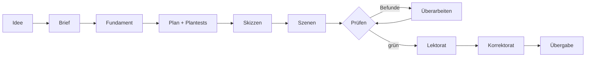

  

<h1 align="center">Sommer auf Gut Lindenhof</h1>

<strong>Karla Lind</strong> · Ein Liebesroman im Heftformat

Eine Gärtnerin, ein verwilderter Rosengarten und ein Erbe aus Hamburg, der verkaufen will. Geschrieben in einer Buchfabrik: Agenten schreiben, Tests entscheiden.

## In English

*Sommer auf Gut Lindenhof* is a German romance novel produced end to end by a book factory modelled on the agentic software factory: AI agents plan, write and revise, 497 deterministic checks with stable IDs gate every step, and a human approves at fixed gates. From a five-line idea to EPUB and PDF took 54 hours, 515 agent runs and 48 million tokens. The style was calibrated on measured statistics of two openly licensed novels. This repository is the book plus its complete trail: plan tests, findings, approvals and every commit.

## Die Buchfabrik in vier Sätzen

Was die Agentic Software Factory für Code ist, ist die Buchfabrik für Romane. KI-Agenten planen, schreiben und überarbeiten. Hunderte deterministische Prüfungen entscheiden, ob ein Kapitel weiterdarf, und an festen Gates gibt ein Mensch frei. Von einer Idee in fünf Zeilen bis zu EPUB und PDF vergingen 54 Stunden, und dieses Repo ist das Ergebnis, mit seiner vollständigen Commit-Spur.

## Das Buch

> Ein verwilderter Rosengarten. Ein Erbe, der verkaufen will. Und nur ein Sommer bis zum Erntefest.
>
> Als Gärtnerin Marie Albers den Auftrag annimmt, den Rosengarten von Gut Lindenhof zu retten, ahnt sie nicht, dass ihr Auftraggeber sie so auf die Palme bringen wird. Jonas Behrendt, Bauingenieur aus Hamburg, will Wege planieren, Termine einhalten und das Gut so schnell wie möglich loswerden. Marie will nur eines: dass Hedwigs letzte Lindenhof-Rose wieder blüht.
>
> Doch der Sommer auf dem Land hat seine eigenen Pläne. Gretes Kuchen, Hannes' Trecker, Lenas Helferliste und ein Abend am Gutssee bringen Marie und Jonas näher, als beiden lieb ist. Und Jonas entdeckt, dass er auf diesem Gut einmal zu Hause war.
>
> Doch zwischen ihnen steht eine Entscheidung, die Jonas allein treffen muss – und ein Geheimnis, das Marie das Herz brechen könnte.
>
> Ein Roman über Rosen, Rückschnitt und den Mut, Wurzeln zu schlagen.

10 Kapitel, 27 Szenen, rund 23.700 Wörter.

## Software Factory, auf Bücher angewandt

Die Fabrik übernimmt die Arbeitsweise guter Softwareteams und überträgt sie Schritt für Schritt aufs Erzählen:

| Software                | Buch                                                  |
| ----------------------- | ----------------------------------------------------- |
| Spezifikation           | Brief: Zielgruppe, Ton, Versprechen an die Leserin    |
| Architektur             | Fundament: Prämisse, Figuren, Orte, Handlungsstränge  |
| Unit-Tests              | Plantests je Szene, geschrieben vor dem ersten Satz   |
| Linter                  | Prüfregeln mit fester ID, jede mit eigenem Test       |
| Code-Review             | Kapitelprüfung, Lektorat, simulierte Testleserinnen   |
| CI-Gates                | Freigaben an jeder Station                            |
| Feature-Branch          | Fabrik-Strang, gemergt erst, wenn alles grün ist      |
| Release                 | Übergabe: EPUB, PDF, Cover, Shop-Daten                |

Die Regel dahinter: Was sich zählen lässt, zählt ein Programm und kein Modell. Das Modell urteilt nur dort, wo es um Urteile geht, und auch dann muss es jeden Befund an einem Zitat im Text belegen.

## In Zahlen

| | |
| --- | --- |
| Von der Idee zum fertigen Buch | 54 Stunden |
| Reine Rechenzeit der Agenten | 18,6 Stunden |
| Agentenläufe | 515 |
| Token | 48 Millionen |
| Commits | rund 640 |
| Plantests | 492 |
| Überarbeitungen | 78, an 24 von 27 Szenen, höchstens 5 je Szene |
| Kapitelprüfungen / Nachprüfungen / Konsistenzläufe | 70 / 50 / 14 |
| Vorlese-Durchgänge (nur Klang) | 10 |
| Simulierte Testleserinnen / Lektorate | 2 / 1 |
| Befunde | 683, davon 127 behoben, der Rest größtenteils Hinweise |

## Deterministische Prüfungen

497 Regeln, jede mit stabiler ID und eigenem Test. Sie laufen bei jedem Schritt, so wie ein Linter bei jedem Commit.

| Familie | Regeln | Ein Beispiel |
| --- | ---: | --- |
| KI-Ton und Floskeln | 248 | Formeln, an denen man maschinellen Text erkennt |
| Plan und Struktur | 67 | Heldin und Held sind zu viele Szenen nacheinander getrennt |
| Fakten, Quellen, Zeitleiste, Orte | 36 | Eine Figur ist zur selben Zeit an zwei Orten |
| Veröffentlichung, Cover, Shop | 36 | Das Cover ist für den Shop zu klein |
| Prozess und Nachvollziehbarkeit | 29 | Ein Befund zitiert Text, der so nicht im Buch steht |
| Erzählhandwerk und Genre | 26 | Der Körper trägt das Gefühl („das Herz hämmerte“) |
| Stil und Messung | 25 | Die Satzlängen verlassen den geeichten Korridor |
| Figurenwissen und Konsistenz | 16 | Eine Figur nutzt Wissen, das sie erst später erfährt |
| Typografie und Korrektorat | 14 | Falsche Anführungszeichen, Rechtschreibung |

Schwellenwerte und Verfahren bleiben in der Werkstatt.

## Stil geeicht, nicht kopiert

Die Stilvorlage „Heftroman“ ist gemessen, nicht erfunden. Grundlage sind zwei Heftromane, die ihre Autorin unter einer freien Lizenz veröffentlicht hat. Gemessen wurden nur Kennzahlen wie Satzlänge, Anteil kurzer Sätze, Dialoganteil, Szenenlänge und die Verteilung der Perspektiven. Das ist Text- und Data-Mining nach § 44b UrhG. Nach dem ersten Lauf wurden die Werte am eigenen Text nachgeeicht.

## Was hier bewusst fehlt

Prompts, Skills, Regelschwellen und die Wahl der Modelle. Das ist das Werkzeug, nicht das Buch.

## Rundgang durchs Repo

- `manuscript/`: der Text, eine Datei je Szene
- `plan/`: Kapitelpläne und die Plantests, gegen die jede Szene lief
- `bible/`: das Wiki aus Figuren, Orten und Welt
- `review/`: der Lektoratsbrief
- `ledger/`: Befunde, Läufe mit Token, Freigaben, Korrekturen
- `marketing/`: Klappentexte, Cover-Brief, Shop-Daten
- die Git-Historie: jeder Schritt der Fabrik als eigener Commit

## KI-Kennzeichnung, Lizenz, Impressum

Text und Cover sind mit KI erzeugt und an jedem Gate geprüft und freigegeben.

Lizenz: [CC BY-NC-ND 4.0](https://creativecommons.org/licenses/by-nc-nd/4.0/deed.de), siehe [LICENSE.md](LICENSE.md).

Impressum: <https://github.com/BjoernSchotte/>
